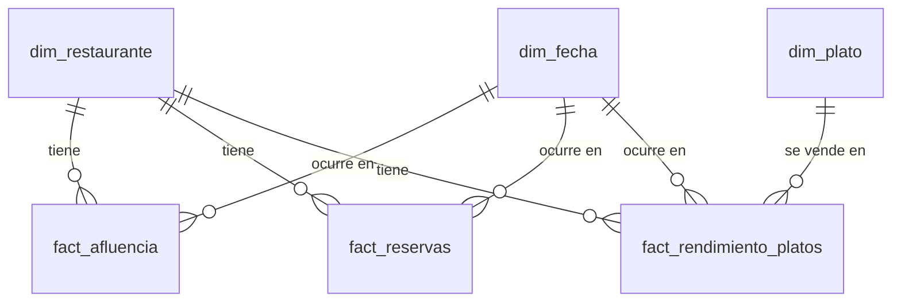

# Esquema de datos · smart-restaurant

Diseño lógico de los datos del proyecto (Proyecto Final 1 · Big Data e IA).
Los datos son **sintéticos** y se generan con `data/generar_datasets.py` (semilla fija).

> **Cómo leer este documento.** Los CSV originales (capa *raw*) están sucios a propósito.
> Este esquema describe cómo deben quedar los datos **después de limpiarlos** (capa *clean*):
> los tipos, las claves y las reglas son el **objetivo** de la limpieza.

## 0. Visión general

Se usa un **modelo en estrella**: tablas de *hechos* (lo que se mide) rodeadas de tablas de *dimensiones* (el contexto).

| Tipo | Tabla | Origen | Filas aprox. (por lote) |
|---|---|---|---|
| Hechos | `fact_afluencia` | `afluencia_diaria_*.csv` | 46.784 hist. / 11.584 drift |
| Hechos | `fact_reservas` | `reservas_diarias_*.csv` | 93.568 / 23.168 |
| Hechos | `fact_rendimiento_platos` | `rendimiento_platos_*.csv` | 561.408 / 139.008 |
| Dimensión | `dim_restaurante` | extraída de `afluencia_diaria_*` | 64 |
| Dimensión | `dim_plato` | extraída de `rendimiento_platos_*` | 12 |
| Dimensión | `dim_fecha` | calendario 2024-01-01 a 2026-06-30 | 912 días |

Las filas de las tablas de hechos son las **filas originales sin duplicados** (`filas_originales` de `data/resumen_ensuciado.json`).

Dos lotes comparten el mismo esquema:
- **historico**: 2024-01-01 a 2025-12-31 (731 días).
- **lote_drift**: 2026-01-01 a 2026-06-30 (181 días), con comportamiento distinto a propósito (drift).

Al cargar los datos limpios, cada tabla de hechos incorpora una columna **`lote`** (`historico` o `lote_drift`), tomada de la carpeta de origen en HDFS, para poder distinguirlos.

## 1. Granularidad (qué representa una fila)

| Tabla | Una fila es… | Clave primaria |
|---|---|---|
| `fact_afluencia` | un restaurante en un día | `id_registro` |
| `fact_reservas` | un restaurante, un día y un turno (comida/cena) | `id_registro` |
| `fact_rendimiento_platos` | un restaurante, un día y un plato | `id_registro` |
| `dim_restaurante` | un restaurante | `id_restaurante` |
| `dim_plato` | un plato de la carta | `id_plato` |
| `dim_fecha` | un día natural | `fecha` |

Formato de los identificadores: `AFL-RST-0001-20240101`, `RES-RST-0001-20240101-comida`, `VEN-RST-0001-20240101-01`.

## 2. Dimensiones

### `dim_restaurante` (64 filas, `RST-0001` a `RST-0064`)

| Columna | Tipo | Descripción / valores válidos |
|---|---|---|
| `id_restaurante` **PK** | STRING | Formato `RST-NNNN` |
| `ciudad` | STRING | Donostia, Bilbao, Vitoria-Gasteiz, Pamplona, Santander, Logroño, Burgos, Oviedo |
| `provincia` | STRING | Gipuzkoa, Bizkaia, Araba, Navarra, Cantabria, La Rioja, Burgos, Asturias (según la ciudad) |
| `tipo_restaurante` | STRING | `casual`, `bistró`, `familiar`, `tradicional` |
| `capacidad_asientos` | INT | Entre 35 y 110. Es constante para cada restaurante |

### `dim_plato` (12 filas, `PLT-001` a `PLT-012`)

| Columna | Tipo | Descripción / valores válidos |
|---|---|---|
| `id_plato` **PK** | STRING | Formato `PLT-NNN` |
| `nombre_plato` | STRING | Hamburguesa clásica, Pizza margarita, Ensalada de temporada, Croquetas caseras, Pasta boloñesa, Solomillo a la plancha, Arroz de verduras, Salmón al horno, Tarta de queso, Brownie de chocolate, Patatas bravas, Sopa del día |
| `categoria` | STRING | `Entrante`, `Principal`, `Postre` |

### `dim_fecha` (912 días)

| Columna | Tipo | Descripción / valores válidos |
|---|---|---|
| `fecha` **PK** | DATE | `yyyy-mm-dd` |
| `dia_semana` | STRING | `lunes` … `domingo` |
| `mes` | TINYINT | 1 a 12 |
| `anio` | SMALLINT | 2024, 2025, 2026 |
| `temporada` | STRING | `invierno` (dic-feb), `primavera` (mar-may), `verano` (jun-ago), `otoño` (sep-nov) |
| `es_festivo` | TINYINT | 0/1. Festivos: 1-ene, 6-ene, 1-may, 15-ago, 12-oct, 1-nov, 6-dic, 8-dic, 25-dic |

> **Importante:** `dim_fecha` se construye a partir del **calendario**, no de los CSV. En los CSV sucios estas columnas pueden venir corruptas (`dia_semana = "Funday"`, `mes = 14`…).

## 3. Tablas de hechos

### `fact_afluencia`

| Columna | Tipo | Notas |
|---|---|---|
| `id_registro` **PK** | STRING | Único tras eliminar duplicados |
| `id_restaurante` **FK** → `dim_restaurante` | STRING | |
| `fecha_servicio` **FK** → `dim_fecha` | DATE | |
| `lote` | STRING | `historico` / `lote_drift` |
| `evento_local_previsto` | TINYINT | 0/1 |
| `temperatura_prevista_c` | DECIMAL(4,1) | Previsión, °C |
| `lluvia_prevista_mm` | DECIMAL(5,1) | Previsión, mm. Mínimo 0 |
| `horas_apertura_planificadas` | TINYINT | 8 o 10 (10 los viernes y sábados) |
| `fecha_corte_prediccion` | TIMESTAMP | Día anterior a las 23:59 |
| `clientes_reales` | INT | ≥ 0 |
| `clientes_con_reserva_reales` | INT | ≥ 0 |
| `clientes_sin_reserva_reales` | INT | ≥ 0 |

Columnas del CSV que **pasan a dimensiones** (se eliminan de la tabla de hechos): `ciudad`, `provincia`, `tipo_restaurante`, `capacidad_asientos` → `dim_restaurante`; `dia_semana`, `mes`, `temporada`, `festivo_simulado` → `dim_fecha`.

### `fact_reservas`

| Columna | Tipo | Notas |
|---|---|---|
| `id_registro` **PK** | STRING | |
| `id_restaurante` **FK** → `dim_restaurante` | STRING | |
| `fecha_servicio` **FK** → `dim_fecha` | DATE | |
| `lote` | STRING | |
| `turno` | STRING | `comida` o `cena` |
| `fecha_corte_prediccion` | TIMESTAMP | |
| `reservas_confirmadas_corte` | INT | ≥ 0 |
| `comensales_reservados_corte` | INT | ≥ 0 |
| `reservas_web_corte` | INT | ≥ 0 |
| `reservas_telefono_corte` | INT | ≥ 0 |
| `antelacion_media_dias_corte` | DECIMAL(5,2) | ≥ 0. Es 0 si no hay reservas |
| `comensales_cancelados_final` | INT | ≥ 0 |
| `comensales_no_show_final` | INT | ≥ 0 |
| `comensales_asistentes_final` | INT | ≥ 0 |
| `reservas_nuevas_dia_comensales` | INT | ≥ 0. Reservas que entran el mismo día |

### `fact_rendimiento_platos`

| Columna | Tipo | Notas |
|---|---|---|
| `id_registro` **PK** | STRING | |
| `id_restaurante` **FK** → `dim_restaurante` | STRING | |
| `fecha_servicio` **FK** → `dim_fecha` | DATE | |
| `id_plato` **FK** → `dim_plato` | STRING | |
| `lote` | STRING | |
| `ofertado` | TINYINT | 0/1 |
| `precio_unitario_eur` | DECIMAL(6,2) | > 0 |
| `coste_unitario_eur` | DECIMAL(6,2) | > 0 |
| `unidades_vendidas` | INT | ≥ 0 |
| `descuento_medio_pct` | DECIMAL(4,1) | Solo toma los valores 0, 5, 10 o 15 |
| `ventas_netas_eur` | DECIMAL(10,2) | |
| `coste_total_eur` | DECIMAL(10,2) | |
| `margen_contribucion_eur` | DECIMAL(10,2) | Puede ser negativo en teoría |
| `canal_venta` | STRING | En estos datos solo existe el valor `sala` (columna constante) |

Columnas del CSV que **pasan a `dim_plato`**: `nombre_plato`, `categoria`.

## 4. Relaciones



| Relación | Cardinalidad |
|---|---|
| `dim_restaurante` → `fact_afluencia` / `fact_reservas` / `fact_rendimiento_platos` | 1 a N |
| `dim_plato` → `fact_rendimiento_platos` | 1 a N |
| `dim_fecha` → las tres tablas de hechos | 1 a N |

Claves de negocio (combinaciones únicas, útiles para detectar duplicados que tengan distinto `id_registro`):
- `fact_afluencia`: (`id_restaurante`, `fecha_servicio`)
- `fact_reservas`: (`id_restaurante`, `fecha_servicio`, `turno`)
- `fact_rendimiento_platos`: (`id_restaurante`, `fecha_servicio`, `id_plato`)

## 5. Reglas de coherencia (para validar la limpieza)

Se deducen de la lógica de `generar_datasets.py`. En datos limpios deben cumplirse (con tolerancia de 0,01 € en importes por el redondeo):

**Dentro de `fact_afluencia`**
- `clientes_reales = clientes_con_reserva_reales + clientes_sin_reserva_reales`

**Dentro de `fact_reservas`**
- `reservas_confirmadas_corte = reservas_web_corte + reservas_telefono_corte`
- `comensales_asistentes_final = comensales_reservados_corte − comensales_cancelados_final − comensales_no_show_final + reservas_nuevas_dia_comensales`

**Dentro de `fact_rendimiento_platos`**
- `ventas_netas_eur = unidades_vendidas × precio_unitario_eur × (1 − descuento_medio_pct / 100)`
- `coste_total_eur = unidades_vendidas × coste_unitario_eur`
- `margen_contribucion_eur = ventas_netas_eur − coste_total_eur`
- Si `ofertado = 0`, entonces `unidades_vendidas = 0` y `descuento_medio_pct = 0`

**Entre tablas**
- Para un mismo restaurante y día: `clientes_con_reserva_reales` (afluencia) = suma de `comensales_asistentes_final` de los turnos `comida` y `cena` (reservas).
- Cada `id_restaurante` e `id_plato` de los hechos debe existir en su dimensión.
- Las unidades vendidas de platos **pueden superar** a los clientes: un cliente puede pedir varios platos. No es un error.

**Valores válidos de categorías y rangos**
- `mes` entre 1 y 12; `horas_apertura_planificadas` ∈ {8, 10}; `descuento_medio_pct` ∈ {0, 5, 10, 15}.
- Marcadores binarios (`evento_local_previsto`, `ofertado`, `es_festivo`) ∈ {0, 1}.
- `turno` ∈ {`comida`, `cena`}; `dia_semana` ∈ {`lunes` … `domingo`}.
- Contadores (clientes, reservas, unidades) ≥ 0; precios y costes > 0.

## 6. Qué se sabe y cuándo (evitar *data leakage*)

`fecha_corte_prediccion` indica hasta cuándo se conocía la información (el día anterior a las 23:59). Al construir modelos hay que separar:

| Momento | Columnas |
|---|---|
| **Antes del servicio** (se pueden usar para predecir) | datos de `dim_restaurante`, `dim_fecha` y `dim_plato`; `evento_local_previsto`, `temperatura_prevista_c`, `lluvia_prevista_mm`, `horas_apertura_planificadas`; todas las columnas `*_corte` de reservas; `precio_unitario_eur` y `coste_unitario_eur` |
| **Después del servicio** (resultados / lo que se quiere predecir) | `clientes_reales`, `clientes_con_reserva_reales`, `clientes_sin_reserva_reales`; `comensales_cancelados_final`, `comensales_no_show_final`, `comensales_asistentes_final`, `reservas_nuevas_dia_comensales`; `unidades_vendidas`, `descuento_medio_pct`, `ventas_netas_eur`, `coste_total_eur`, `margen_contribucion_eur` |

Ejemplo de error a evitar: usar `clientes_reales` como variable de entrada para predecir `clientes_reales`.

## 7. Decisiones de diseño

1. **Modelo en estrella.** Evita repetir miles de veces atributos como la ciudad de un restaurante o el nombre de un plato, y facilita agrupar y filtrar.
2. **No se imponen claves foráneas en la capa raw.** Los datos traen claves huérfanas a propósito (`id_restaurante = RST-9999`, `id_plato` con `NA`, `NULL`, `sin dato` o vacío). Si se exigieran, esas filas no se cargarían y no se podrían limpiar. Las relaciones se **validan después de limpiar**, en `/datalake/clean`.
3. **Capa raw intocable.** `/datalake/raw` conserva los CSV tal cual; el resultado de la limpieza va a `/datalake/clean`.
4. **Un solo esquema para los dos lotes**, con la columna `lote` para distinguirlos. Esto permite entrenar con el histórico y evaluar con el lote drift.
5. **`dim_fecha` desde el calendario**, no desde los datos sucios, para no heredar sus errores.
6. **Tipos explícitos.** Los CSV traen todo como texto; el tipo correcto de cada columna es el objetivo de la limpieza (fechas a `DATE`, importes a `DECIMAL`, indicadores a `TINYINT`).
7. **Columnas constantes.** `canal_venta` solo vale `sala`; no aporta información, pero se conserva por fidelidad a los datos originales.

## 8. Ubicación en HDFS

```
/datalake/raw/historico/     afluencia_diaria_historico.csv, reservas_diarias_historico.csv, rendimiento_platos_historico.csv
/datalake/raw/lote_drift/    afluencia_diaria_lote_drift.csv, reservas_diarias_lote_drift.csv, rendimiento_platos_lote_drift.csv
/datalake/clean/             (resultado de la limpieza: fact_* y dim_*)
```
